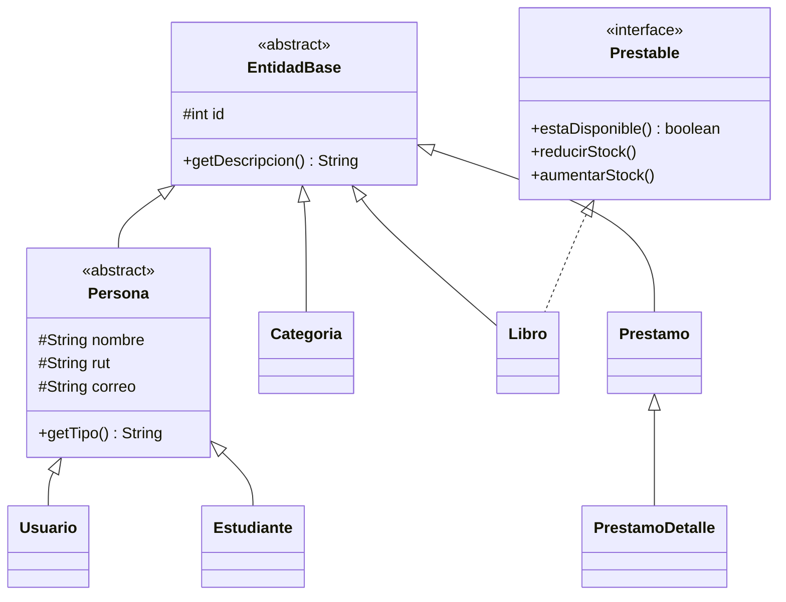

# Sistema de Gestión de Biblioteca Escolar

Evaluación Final Transversal · **Desarrollo Orientado a Objetos II**

Aplicación de **escritorio en Java (Swing / JFrame)** para controlar la circulación de libros en una biblioteca escolar: autenticación por rol, gestión de libros, estudiantes y categorías, préstamos y devoluciones con control de stock concurrente, y reportes. Los datos se guardan en **MySQL** mediante **JDBC**.

- **Autor:** _(escribe aquí tu nombre y sección)_
- **Lenguaje / librerías:** Java 11+ · Swing · MySQL Connector/J 8.4 · Maven
- **Patrones:** MVC · DAO · Singleton (+ Template Method)
- **Concurrencia:** hilo independiente para préstamos y devoluciones + `synchronized` sobre el stock

---

## 1. Requisitos

| Herramienta | Versión |
|---|---|
| JDK | 11 o superior (se probó con 21) |
| IntelliJ IDEA | Community o Ultimate |
| MySQL Server | 8.x (con MySQL Workbench) |

## 2. Puesta en marcha

### 2.1 Base de datos
1. Abre MySQL Workbench y ejecuta **primero** `sql/Script_crea_tablas_biblioteca.sql`.
2. Luego ejecuta `sql/Script_poblado_tablas_biblioteca.sql` (datos de ejemplo).
3. Verifica que existan las tablas `usuarios`, `estudiantes`, `libros`, `categorias` y `prestamos`.

> Si usas los scripts oficiales del curso, reemplaza estos dos archivos por los tuyos. La aplicación detecta automáticamente si las columnas se llaman `contraseña`/`contrasena` y `título`/`titulo`.

### 2.2 Conexión
Edita `src/main/resources/db.properties` con tu base, usuario y contraseña de MySQL:

```properties
db.url=jdbc:mysql://localhost:3306/biblioteca_escolar?...
db.user=root
db.password=TU_CONTRASEÑA
```
También se pueden usar las variables de entorno `DB_URL`, `DB_USER` y `DB_PASSWORD` (así la clave no queda escrita en el repositorio).

### 2.3 Ejecutar desde IntelliJ IDEA
1. `File > Open` y elige la carpeta del proyecto (la que contiene `pom.xml`). Acepta *Trust Project*.
2. Espera a que Maven descargue **MySQL Connector/J**.
3. Abre `src/main/java/biblioteca/Main.java` y pulsa **Run**.

### 2.4 Generar el ejecutable (.jar)
En IntelliJ: panel **Maven > Lifecycle > package** (o `mvn clean package`).
Se crea `target/biblioteca-escolar.jar` (incluye el driver). Cópialo a la carpeta `ejecutable/` y usa `ejecutar.bat` (Windows) o `ejecutar.sh` (Linux/Mac). Junto al .jar puedes editar `db.properties` sin recompilar.

## 3. Usuarios de ejemplo

| Rol | Correo (o RUT) | Contraseña |
|---|---|---|
| Bibliotecario | `admin@biblioteca.cl` (RUT `12.345.678-5`) | `admin123` |
| Bibliotecario | `biblioteca@colegio.cl` | `biblio123` |
| Estudiante | `ana.perez@colegio.cl` | `ana123` |
| Estudiante | `luis.rojas@colegio.cl` | `luis123` |
| Estudiante | `sofia.vargas@colegio.cl` | `sofia123` |

## 4. Funcionalidades por rol

| Módulo | Bibliotecario | Estudiante |
|---|---|---|
| Libros (registrar, modificar, eliminar, visualizar, buscar) | Gestión total | Solo consulta |
| Estudiantes (CRUD + usuario de acceso opcional) | ✔ | — |
| Categorías (CRUD) | ✔ | — |
| Préstamos y devoluciones | Para cualquier estudiante | Solo los propios |
| Reportes: libros más prestados, historial por estudiante, libros en préstamo | ✔ | — |

**Reglas del negocio:** se verifica la disponibilidad del libro; el vencimiento se calcula automáticamente (**fecha de préstamo + 7 días**); los préstamos vencidos se marcan como `ATRASADO (n días)`; si un libro se devuelve con atraso se avisa y se deja constancia en `logs/atrasos.log`.

> Convención sobre la tabla `prestamos`: `fecha_devolucion` guarda la **fecha de vencimiento** y `devuelto` indica si ya fue devuelto. El historial del estudiante es el conjunto de sus filas en `prestamos`.

## 5. Arquitectura

```
src/main/java/biblioteca
├── Main.java
├── modelo/        MODELO   → entidades y reglas (EntidadBase, Persona, Usuario, Estudiante, Libro, Categoria, Prestamo...)
├── dao/           DAO      → acceso a datos con PreparedStatement (GenericDAO, BaseDAO, LibroDAO...) + DatabaseConnection (Singleton)
├── servicio/      MODELO   → lógica de préstamos/devoluciones (PrestamoService, synchronized)
├── hilos/         hilos de segundo plano (TareaSegundoPlano, RegistrarPrestamoTask, RegistrarDevolucionTask)
├── controlador/   CONTROLADOR → escucha eventos de las vistas y coordina DAO/servicio
├── vista/         VISTA    → JFrame y paneles Swing (LoginView, MainView, PanelCrud, PrestamoPanel...)
├── util/          validaciones, fechas, contraseñas, constancia de atrasos
└── pruebas/       PruebaConcurrencia (prueba del control de stock)
```

### Patrones de diseño
- **MVC:** las vistas solo muestran y entregan datos; los controladores manejan los eventos y llaman al modelo; el modelo y los DAO contienen los datos y las reglas.
- **DAO:** una clase por entidad (`LibroDAO`, `EstudianteDAO`, `UsuarioDAO`, `CategoriaDAO`, `PrestamoDAO`) que solo habla con la base de datos. Todas implementan la interfaz `GenericDAO<T>` (CRUD) y usan `PreparedStatement`.
- **Singleton:** `DatabaseConnection` tiene constructor privado y `getInstance()` estático; mantiene **una única conexión** JDBC (`DriverManager.getConnection`) y la reabre si se pierde. Lee `db.properties`/variables de entorno.

### Programación orientada a objetos

- **Herencia y clases abstractas:** `EntidadBase` → `Persona` → `Usuario` / `Estudiante`; `Prestamo` → `PrestamoDetalle`; también `BaseDAO`, `PanelCrud<T>`, `CrudController<T>` y `TareaSegundoPlano<R>`.
- **Interfaces:** `GenericDAO<T>` (implementada por los 5 DAO) y `Prestable` (implementada por `Libro`).
- **Polimorfismo:** `getDescripcion()` se redefine en cada entidad y alimenta combos y listas; `CrudController<T>` guarda libros, estudiantes o categorías con el mismo código usando `GenericDAO<T>`.

## 6. Concurrencia y consistencia del stock
- **Hilo independiente:** al pulsar *Registrar préstamo*, `RegistrarPrestamoTask` (un `Runnable`) corre en un hilo aparte: registra el préstamo, actualiza el stock y recarga el historial del estudiante. El resultado vuelve a la pantalla con `SwingUtilities.invokeLater`. La barra de progreso sigue animada: la interfaz **no se congela**. Con `-Dbiblioteca.retardo=0` se quita la pausa de demostración (1,2 s).
- **Sincronización:** `PrestamoService.registrarPrestamo` y `registrarDevolucion` son métodos `synchronized`, igual que `LibroDAO.descontarStock`, `reponerStock` y `actualizar`. Además el descuento usa `UPDATE ... WHERE stock > 0` (atómico en MySQL). Si falla el registro del préstamo, el stock se repone.
- **Prueba:** ejecuta `biblioteca.pruebas.PruebaConcurrencia`: crea un libro temporal con 3 ejemplares, lanza 10 hilos simultáneos y verifica que se presten exactamente 3 y que el stock final sea 0. Luego borra los datos de prueba.

## 7. Estructura del repositorio
```
BibliotecaEscolar/
├── pom.xml                 Proyecto Maven (MySQL Connector/J + empaquetado .jar)
├── sql/                    Scripts de creación y poblado
├── src/                    Código fuente
├── ejecutable/             Aquí va biblioteca-escolar.jar + ejecutar.bat / ejecutar.sh + db.properties
└── README.md
```
